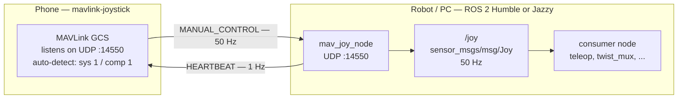

# mav_joy

The package with ROS 2 (Humble / Jazzy) node that turns the [mavlink-joystick](https://github.com/goldarte/mavlink-joystick) app into a ROS2 joystick:



## Install required packages

First of all - you need ROS2 Humble/Jazzy to be installed.

Then you need to install some packages:

```bash
export ROS_DISTRO=humble                       # or jazzy
source /opt/ros/$ROS_DISTRO/setup.bash

# Rust message generator and the message packages
sudo apt install ros-$ROS_DISTRO-rosidl-generator-rs \
                 ros-$ROS_DISTRO-std-msgs ros-$ROS_DISTRO-sensor-msgs \
                 ros-$ROS_DISTRO-geometry-msgs ros-$ROS_DISTRO-builtin-interfaces \
                 ros-$ROS_DISTRO-test-msgs build-essential \
                 python3-colcon-common-extensions

# Rust toolchain
curl --proto '=https' --tlsv1.2 -sSf https://sh.rustup.rs | sh -s -- -y
echo '[ -f "$HOME/.cargo/env" ] && . "$HOME/.cargo/env"' >> ~/.bashrc

# colcon-ros-cargo
sudo apt install python3-pip
python3 -m pip install --user colcon-ros-cargo
```

Then you need to clone repo and populate ros-\<distro\>-* rust packages through a user-local ament prefix:

```bash
git clone https://github.com/goldarte/mavlink-joy-ros2.git
cd mavlink-joy-ros2
./scripts/register-ros-rust-index.sh   # once, or after installing/switching a distro

# If you plan to build package right after installation:
source .bashrc
```

## Build

```bash
colcon build
```

After that you will be able to build the package directly with cargo too:

```bash
cargo test && cargo build
```

## Run

```bash
ros2 run mav_joy mav_joy_node
```

`/joy` stays silent until the first `MANUAL_CONTROL` arrives (no invented stick positions).

After `timeout_sec` without a message the node publishes neutral values (sticks centred, throttle zero) once per tick and logs a warning, so consumers see a failsafe instead of frozen sticks.

## Parameters

| Parameter | Type | Default | Meaning |
|---|---|---|---|
| `joy_topic` | string | `/joy` | Topic the joystick messages are published on |
| `frame_id` | string | `mavlink_joystick` | `header.frame_id` of the published messages |
| `publish_rate_hz` | double | `50.0` | Republish rate of `/joy` |
| `bind_address` | string | `0.0.0.0` | Local UDP address |
| `bind_port` | int | `14550` | Local UDP port the app sends to (`0` picks a free one) |
| `app_address` | string | `255.255.255.255` | Where heartbeats are sent until the app is heard |
| `app_port` | int | `14550` | UDP port the app listens on |
| `heartbeat_rate_hz` | double | `1.0` | Rate of the `HEARTBEAT` that enables the app's discovery |
| `system_id` | int | `1` | MAVLink system id of this node |
| `component_id` | int | `1` | MAVLink component id of this node |
| `timeout_sec` | double | `1.0` | Link timeout; `0` disables the failsafe |

## `/joy` mapping

| `/joy` | `MANUAL_CONTROL` | Range | Meaning |
|---|---|---|---|
| `axes[0]` | `y` | -1..1 | roll, positive right |
| `axes[1]` | `-x` | -1..1 | pitch, positive nose up |
| `axes[2]` | `z` | -1..1 | throttle (`0..1` with the app) |
| `axes[3]` | `r` | -1..1 | yaw, positive clockwise |
| `buttons[0..16]` | `buttons` | 0/1 | the 16 bits of the button bitfield |

Values are the raw MAVLink payload divided by 1000

## Test without a phone

`cargo test` covers the protocol mapping and talks to a real UDP socket. For a full ROS check, `scripts/fake_app.py` plays the app:

```bash
# terminal 1
ros2 run mav_joy mav_joy_node --ros-args -p bind_port:=14551 -p app_address:=127.0.0.1 -p app_port:=14555
# terminal 2
python3 scripts/fake_app.py 14555 20
# terminal 3
ros2 topic echo /joy
```

## Troubleshooting

1. **No /joy messages**.

    The node runs normally and logs `MANUAL_CONTROL from system 255 component 190` but `ros2 topic list` has no `/joy` and `ros2 node list` is empty.

    The reason is that ROS2 daemon caches the graph and misses participants that appeared after it was started (it also keeps stale discovery state after a network change). Check without the daemon and restart it:

    ```bash
    ros2 node list --no-daemon        # -> /mav_joy_node
    ros2 topic list --no-daemon       # -> /joy
    ros2 daemon stop                  # the next ros2 command starts a fresh daemon
    ```

2. **The node logs `nothing has been received from the app for 10s`.**

    `/joy` topic stays empty while the app shows a link.

    There are 3 possible reasons for that:

    * **Wrong `bind_port`.** It must be the app's listen port (14550 by default) and the app's drone system/component ids must be `1`/`1`.

    * **The network drops unicast between clients.** Guest and corporate Wi-Fi often floods broadcast (that is why the app still sees the link) but not client-to-client unicast, so the app's `MANUAL_CONTROL` never arrives. If you don't own the router, you can do nothing with this.

    * **The app sends to an address this machine no longer has.** Leave the node off until the app shows `NO LINK` and start it again.
